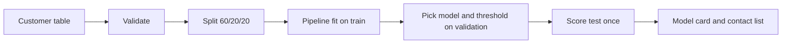
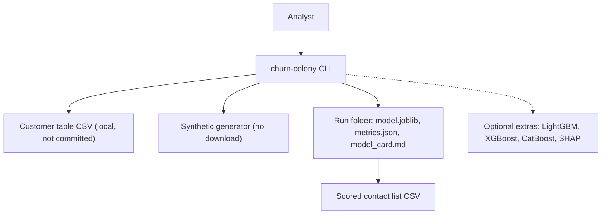
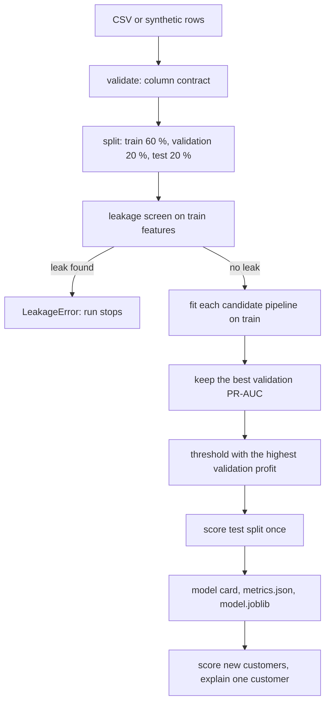

<div align="center">

# churn-colony — Leak-Free Telecom Churn Models with Ant Colony Feature Selection

**churn-colony is a churn model kit for telecom retention teams. It takes a customer table through these steps to a ranked contact list and a model card:**

`validate` → `split` → `engineer features` → `select (ACO)` → `fit and compare` → `pick threshold by profit` → `explain`.


**[Summary](#1-summary)** ·
**[Workflow](#4-the-end-to-end-workflow)** ·
**[Run it](#10-how-to-run-churn-colony)** ·
**[Configuration](#104-environment-variables)** ·
**[Known problems](#13-known-problems)** ·
**[Glossary](#15-glossary)**

</div>

> [!NOTE]
> This README uses ASD-STE100 Simplified Technical English. The writing rules and the project
> vocabulary are in [`docs/ste-style-guide.md`](docs/ste-style-guide.md). Each term in the
> [Glossary](#15-glossary) has only one meaning.

---

churn-colony predicts which telecom customers will leave, and it ranks them for a retention offer.
All fitted steps live in one scikit-learn pipeline: engineered features, encoding, the ant colony selector, class balance and the model.
Thus each step learns from training rows only, and no score comes from rows that the pipeline saw.
The decision threshold comes from a cost model, not from the default 0.5.

This README is the **one location that explains all of churn-colony**. It gives these topics:

- the general design
- each component and its procedure, step by step
- the decision rules
- the data map
- the runbook
- the validation results and the known problems

| If you are… | Read |
|---|---|
| A manager or reviewer | [1](#1-summary), [3](#3-design-rules), [4](#4-the-end-to-end-workflow), [12](#12-validation-results), [14](#14-key-points) |
| A developer who joins the project | All sections, in sequence. Keep [10](#10-how-to-run-churn-colony) and [13](#13-known-problems) open while you work |
| An operator who runs churn-colony | [10](#10-how-to-run-churn-colony), then the section for the component that you use |

---

## Table of contents

1. 🧭 [Summary](#1-summary)
2. 🏗️ [How churn-colony is built](#2-how-churn-colony-is-built)
   - 2.1 [Components](#21-components)
   - 2.2 [System context](#22-system-context)
   - 2.3 [Repository layout](#23-repository-layout)
3. 🛡️ [Design rules](#3-design-rules)
4. 🔄 [The end-to-end workflow](#4-the-end-to-end-workflow)
   - 4.1 [Full flow](#41-full-flow)
   - 4.2 [The life cycle of one run](#42-the-life-cycle-of-one-run)
5. 🔵 [The column contract and the features](#5-the-column-contract-and-the-features)
6. 🐜 [The ant colony selector](#6-the-ant-colony-selector)
7. 🟣 [Models, resampling and tuning](#7-models-resampling-and-tuning)
8. ⚖️ [Evaluation and the cost model](#8-evaluation-and-the-cost-model)
9. 🗂️ [Data and file map](#9-data-and-file-map)
10. ▶️ [How to run churn-colony](#10-how-to-run-churn-colony)
    - 10.1 [Prerequisites](#101-prerequisites) · 10.2 [Installation](#102-installation) · 10.3 [Run churn-colony](#103-run-churn-colony) · 10.4 [Environment variables](#104-environment-variables)
11. 🧩 [How to extend churn-colony](#11-how-to-extend-churn-colony)
12. ✅ [Validation results](#12-validation-results)
13. ⚠️ [Known problems](#13-known-problems)
14. 📌 [Key points](#14-key-points)
15. 📖 [Glossary](#15-glossary)
16. 📄 [License](#16-license)

---

## 1. Summary

**The problem.** A retention team has a limited budget, and it must decide which customers get an offer. These questions are difficult:

- Which columns are known at prediction time, and which columns contain the answer?
- How do you select a small column subset without a selection bias on the test rows?
- How do you balance the classes without synthetic rows in the validation folds?
- How do you compare models on ranking quality and not on hard labels?
- Where do you put the threshold when a contact costs money?

churn-colony gives each of these questions its own component. Each component is a scikit-learn step, a pure function or a CLI command.

| Item | Value |
|---|---|
| Input | A customer table with the 21 columns of the public IBM Telco file, or synthetic rows |
| Output | A run folder: `model.joblib`, `metrics.json` and `model_card.md`. Also a scored contact list |
| Components | **15** modules: config, schema, synthetic, data, features, selection, resample, models, tuning, metrics, cost, explain, experiment, report, cli |
| Models | `logreg` (baseline), `rf`, `hgb`, `stack` in the core. `lightgbm`, `xgboost`, `catboost` as optional extras |
| Selectors | `none`, `l1`, `rfe`, `aco` |
| Offline mode | All commands. With no CSV, the commands generate synthetic customers |
| Safety | The leakage screen stops a run if one column alone separates churners with AUC 0.95 or more |
| Tests | **51** unit tests pass, 3 skip without the `boost` extra (`pytest`) |



---

## 2. How churn-colony is built

### 2.1 Components

| Component | Module | Purpose |
|---|---|---|
| Settings | `src/churn_colony/config.py` | Environment variables and a local `.env` loader |
| Column contract | `src/churn_colony/schema.py` | Required columns, allowed values, ranges, consistency rules |
| Synthetic data | `src/churn_colony/synthetic.py` | Fake Telco-like customers from a known logistic model |
| Data | `src/churn_colony/data.py` | Load a CSV or synthetic rows. Stratified, seeded 60/20/20 split |
| Features | `src/churn_colony/features.py` | `TelcoFeatures` transformer and the leakage screen |
| Selectors | `src/churn_colony/selection.py` | `AntColonySelector`, L1 and RFE selectors |
| Resampling | `src/churn_colony/resample.py` | SMOTE and random oversampling inside `fit` only |
| Models | `src/churn_colony/models.py` | Model factory, preprocessor and `build_pipeline` |
| Tuning | `src/churn_colony/tuning.py` | Randomised search and nested cross-validation |
| Metrics | `src/churn_colony/metrics.py` | ROC-AUC, PR-AUC, Brier, bootstrap intervals, calibration, lift |
| Cost model | `src/churn_colony/cost.py` | Profit of a contact list and the best threshold |
| Explanations | `src/churn_colony/explain.py` | Permutation importance, per-customer effects, optional SHAP |
| Experiment | `src/churn_colony/experiment.py` | `train`, `compare_selectors`, `evaluate`, `score`, run folder I/O |
| Model card | `src/churn_colony/report.py` | `model_card.md` from the run summary |
| CLI | `src/churn_colony/cli.py` | The `churn-colony` command with 8 subcommands |

### 2.2 System context



### 2.3 Repository layout

```
churn-colony/
├── .github/workflows/ci.yml        # CI: Python 3.11, pip install -e ".[dev]", pytest -q
├── .env.example                    # 7 environment variables, all values empty
├── pyproject.toml                  # package, extras (boost, shap, all, dev), churn-colony script
├── data/README.md                  # source, terms, expected columns, download steps
├── docs/ste-style-guide.md         # writing rules and project vocabulary
├── src/churn_colony/
│   ├── config.py  schema.py        # settings and the column contract
│   ├── synthetic.py  data.py       # synthetic customers, load and split
│   ├── features.py                 # engineered features and the leakage screen
│   ├── selection.py  resample.py   # ant colony selector, baselines, SMOTE inside fit
│   ├── models.py  tuning.py        # pipeline factory, search and nested CV
│   ├── metrics.py  cost.py         # probability metrics, calibration, profit and threshold
│   ├── explain.py  report.py       # importance, per-customer effects, model card
│   └── experiment.py  cli.py       # train, compare, evaluate, score and the command line
└── tests/                          # 54 tests (51 run in CI, 3 need the boost extra)
```

---

## 3. Design rules

### 3.1 No feature reads the target
`TelcoFeatures` uses only the columns of one customer row. It raises `TargetInFeatures` if the frame has a `Churn` column. A test shows that its output does not change when the labels change.

### 3.2 Every fitted step is in one pipeline
The pipeline holds the features, the preprocessor, the selector and the model. Cross-validation, the search and `train` fit the whole pipeline on training rows only. Thus the scaler, the high-value limit and the selected columns never see validation or test rows.

### 3.3 Class balance happens inside fit
`ResampledClassifier` adds SMOTE rows when it fits, and it predicts on the real rows. In a search, each validation fold therefore has only real customers.

### 3.4 Metrics use probabilities
`check_scores` refuses scores that are all 0 or 1 with `HardLabelsError`. ROC-AUC and PR-AUC always use `predict_proba`.

### 3.5 The test split is used once
`train` picks the model and the threshold on the validation split. Then it scores the test split one time and writes the result to the model card.

### 3.6 One seed controls a run
The split, the ants, the inner folds, SMOTE and each model get the seed from `--seed` or `CHURN_COLONY_SEED`. Two runs with the same seed give the same columns and the same scores.

### 3.7 Prototype problems and their fixes

| # | Problem in the earlier prototype | Fix in churn-colony |
|---|---|---|
| 1 | A feature was built from `Churn` (fiber AND churned) | No feature reads the target. The leakage screen stops a run on a leak |
| 2 | Feature selection, a quantile and the scaler saw all rows | All of them are pipeline steps that fit on training rows |
| 3 | AUC came from hard labels | `check_scores` refuses hard labels. All metrics use probabilities |
| 4 | The search cross-validated on SMOTE output | SMOTE is inside `ResampledClassifier.fit`. Nested CV with `churn-colony tune` |
| 5 | The ACO penalty punished small subsets, and no seed was set | `subset_fitness` subtracts a cost for each selected column. One seed for all parts |
| 6 | No baseline and no stacking ensemble | `logreg` baseline and `stack` (logreg, rf, hgb) are candidates by default |
| 7 | Nominal columns got ordinal codes | One-hot encoding with `handle_unknown="ignore"` |
| 8 | A stale loop variable chose the explained customer | `churn-colony explain --customer ID` |
| 9 | No threshold or cost analysis | Threshold with the highest validation profit, lift and calibration in the model card |

---

## 4. The end-to-end workflow

### 4.1 Full flow



### 4.2 The life cycle of one run

1. The CLI reads `.env` and the environment variables.
2. `load` reads the CSV as text, or it generates synthetic rows.
3. `validate` checks the column contract and changes the types.
4. `split` makes three stratified, disjoint splits with the seed.
5. The leakage screen checks each engineered training column.
6. `train` fits each candidate pipeline on the training split.
7. `train` keeps the candidate with the highest validation PR-AUC.
8. The cost model picks the threshold on the validation split.
9. `train` scores the test split one time.
10. `save_run` writes `model.joblib`, `metrics.json` and `model_card.md`.

---

## 5. The column contract and the features

**Purpose.** Refuse a bad customer table early, and add features that are known at prediction time.

| Input | Output |
|---|---|
| A CSV read as text | A typed frame with `Churn` as 0/1, and a `ValidationReport` |

**Procedure (validate)**

1. Check that each of the 21 columns is present.
2. Refuse an empty or repeated `customerID`.
3. Refuse a text value that is not in the allowed list of its column.
4. If `TotalCharges` is blank and `tenure` is 0, use 0.0 and record the fix.
5. Refuse another blank or non-numeric value, and a value outside its range.
6. Refuse a row whose add-on columns disagree with `InternetService` or `PhoneService`.
7. Change `Churn` to 1 for `Yes` and 0 for `No`. Refuse a table with one class.

**Engineered features** (`TelcoFeatures`)

| Feature | Rule | Fitted? |
|---|---|---|
| `avg_monthly_spend` | `TotalCharges / tenure`, or `MonthlyCharges` when tenure is 0 | No |
| `spend_drift` | `MonthlyCharges - avg_monthly_spend` | No |
| `n_addons` | Count of `Yes` in the 6 add-on columns | No |
| `n_streaming` | Count of `Yes` in `StreamingTV` and `StreamingMovies` | No |
| `long_term` | `tenure >= 24` | No |
| `high_value` | `MonthlyCharges` at or above the 75th percentile | Yes, on training rows |
| `autopay` | `PaymentMethod` contains `automatic` | No |
| `fiber_no_support` | Fiber optic internet and no tech support | No |
| `tenure_band` | `0-12`, `13-24`, `25-48`, `49+` months | No |

**Rules**

- The leakage screen scores each column alone. A text column gets the churn rate of its level.
- A column with `max(AUC, 1 - AUC) >= 0.95` stops the run with `LeakageError`.
- `fiber_no_support` replaces the leak of the prototype. It uses the service data only.
- The preprocessor fills gaps (median or most frequent), scales numbers and one-hot encodes text columns.

---

## 6. The ant colony selector

**Purpose.** Find a small subset of encoded columns that keeps the cross-validated score.

| Input | Output |
|---|---|
| The encoded training columns and the target | A column mask (`get_support()`), `best_score_`, `history_` |

**Procedure**

1. Give each encoded column a pheromone of 0.5.
2. For each ant, put column j in the mask with a chance equal to its pheromone, clipped to [0.05, 0.95].
3. If the mask has fewer than `min_features` columns, add the columns with the highest pheromone.
4. Score the mask with 3-fold stratified CV of the inner estimator (ROC-AUC). A cache keeps each score.
5. Calculate the fitness: score minus `size_penalty × selected share`.
6. After all ants, multiply the pheromone by `1 - evaporation`.
7. Add `evaporation ×` the mean of the iteration-best mask and the global-best mask.
8. After `n_iterations`, keep the global-best mask.

| Parameter | Default | Meaning |
|---|---|---|
| `n_ants` | 12 | Masks in each iteration |
| `n_iterations` | 10 | Iterations |
| `evaporation` | 0.25 | Share of pheromone that evaporates in each iteration |
| `size_penalty` | 0.02 | Fitness cost when all columns are selected |
| `cv` | 3 | Inner folds |
| `estimator` | `LogisticRegression(max_iter=2000)` | Inner model |
| `random_state` | the run seed | Seeds the ants, the folds and the inner model |

**Rules**

- For the same score, a smaller mask always has a higher fitness (`subset_fitness`).
- The selector is a pipeline step. In `churn-colony select`, it runs inside each outer fold.
- The global-best fitness never decreases from one iteration to the next.

---

## 7. Models, resampling and tuning

**Purpose.** Compare a simple baseline with stronger models on the same pipeline.

| Model | Class | Notes |
|---|---|---|
| `logreg` | `LogisticRegression` | Baseline, C = 1.0 |
| `rf` | `RandomForestClassifier` | 300 trees, 5 rows for each leaf |
| `hgb` | `HistGradientBoostingClassifier` | Learning rate 0.05, 300 iterations, 15 leaves |
| `stack` | `StackingClassifier` | logreg, rf and hgb, with a logistic final model, 5 inner folds |
| `lightgbm`, `xgboost`, `catboost` | Optional extra `boost` | Imported only when you select them |

| Resampling | What it does |
|---|---|
| `none` | No change |
| `class_weight` | `class_weight="balanced"` on the model |
| `smote` | SMOTE rows between minority neighbours (k = 5), in `fit` only |
| `random` | Copies of random minority rows, in `fit` only |

**Procedure (tune)**

1. Split the rows into 5 outer stratified folds.
2. In each outer training part, run `RandomizedSearchCV` on the whole pipeline: 10 settings, 3 inner folds, ROC-AUC.
3. Score the best inner pipeline on the outer test fold with probabilities.
4. Report the mean and the standard deviation of the outer scores and the best settings of each fold.

**Rules**

- The search spaces are in `PARAM_SPACES`. `stack` has no search space.
- `churn-colony train` does not tune. It uses the defaults above. Use `tune` to measure a search.

---

## 8. Evaluation and the cost model

**Metrics.** All ranking metrics use the churn score.

| Metric | Where |
|---|---|
| ROC-AUC and PR-AUC with a 95 % bootstrap interval (500 resamples) | Test split |
| Brier score, log loss | Validation and test splits |
| ECE and a 10-bin calibration table | Test split |
| Lift in the top 10 % of churn scores | Test split |
| Precision, recall, F1, accuracy and confusion counts | At the threshold and at 0.5 |
| Permutation importance of each raw column (ROC-AUC drop, 5 repeats) | Test split |

**Cost model.** For each customer on the contact list, the campaign pays the contact cost.
If the customer is a churner, the offer keeps the customer with the offer success rate.
A kept customer saves `MonthlyCharges × value months`.

| Setting | Default | Variable |
|---|---|---|
| Contact cost | 25 | `CHURN_COLONY_CONTACT_COST` |
| Offer success rate | 0.25 | `CHURN_COLONY_OFFER_SUCCESS` |
| Value months | 6 | `CHURN_COLONY_VALUE_MONTHS` |

**Decision rules**

| Rule | Value |
|---|---|
| Candidate choice | Highest validation PR-AUC. A tie goes to the later name in alphabetical order |
| Threshold grid | 0.02 to 0.98, step 0.01 |
| Threshold choice | Highest validation profit. A tie goes to the higher threshold |
| Contact flag | `churn_score >= threshold` |
| Leakage stop | Single-column `max(AUC, 1 - AUC) >= 0.95` on training rows |
| Reference policies | Contact nobody (profit 0) and contact everybody |

**Per-customer effects.** `explain_customer` puts each raw column to its training reference value (median or most frequent level).
The effect is the churn score minus the new churn score. A positive effect means that the column increases the churn score of that customer.

---

## 9. Data and file map

| Path | Committed? | Contents |
|---|---|---|
| `data/README.md` | Yes | Source, terms, columns and download steps |
| `data/*.csv` | No (git ignores it) | The real customer table or a synthetic CSV |
| `runs/<name>/model.joblib` | No (git ignores it) | Fitted pipeline, threshold, reference values, cost model, summary |
| `runs/<name>/metrics.json` | No (git ignores it) | Full run summary |
| `runs/<name>/model_card.md` | No (git ignores it) | Model card |
| `.env.example` | Yes | All 7 environment variables, empty |
| `.env` | No (git ignores it) | Local settings |

---

## 10. How to run churn-colony

### 10.1 Prerequisites

| Need | For |
|---|---|
| Python 3.11+ | All components |
| numpy, pandas, scipy, scikit-learn, joblib, threadpoolctl | Core (installed with the package) |
| Extra `boost` (LightGBM, XGBoost, CatBoost) | The optional boosted models |
| Extra `shap` | `explain.shap_values` |
| The IBM Telco CSV | Results on real customers (optional) |

### 10.2 Installation

```bash
git clone https://github.com/KrishnaAnnavaram/churn-colony.git
cd churn-colony
python -m venv .venv
. .venv/bin/activate            # Windows: .venv\Scripts\activate
pip install -e ".[dev]"         # add ,boost,shap for the optional extras
```

### 10.3 Run churn-colony

Offline (synthetic customers, no download):

```bash
churn-colony train                                   # logreg, hgb, stack -> runs/latest
churn-colony train --models logreg,rf --selector aco --resampling smote --out runs/aco
churn-colony select --model logreg                   # none vs l1 vs rfe vs aco, 5-fold CV
churn-colony tune --model hgb                        # nested CV: 5 outer x 3 inner x 10 settings
churn-colony explain --run runs/latest --customer SYN-00042
churn-colony evaluate --run runs/latest --seed 7     # fresh synthetic rows
churn-colony synth --rows 5000 --out data/synthetic_telco.csv
churn-colony score --run runs/latest data/synthetic_telco.csv --out contact_list.csv
```

With the real file:

```bash
churn-colony validate data/WA_Fn-UseC_-Telco-Customer-Churn.csv
churn-colony train --data data/WA_Fn-UseC_-Telco-Customer-Churn.csv --out runs/telco
```

`python -m churn_colony` is the same as `churn-colony`.
An error prints `error: <message>`, and the exit code is 1.

### 10.4 Environment variables

| Variable | Used by | Meaning |
|---|---|---|
| `CHURN_COLONY_DATA` | All data commands | Path to the customer table. Empty: synthetic rows |
| `CHURN_COLONY_SEED` | All data commands | Seed for the split, the models and the synthetic rows. Default 42 |
| `CHURN_COLONY_OUTPUT` | `train` | Parent folder of `latest`. Default `runs` |
| `CHURN_COLONY_CONTACT_COST` | Cost model | Cost of one contact. Default 25 |
| `CHURN_COLONY_OFFER_SUCCESS` | Cost model | Chance that the offer keeps a churner, in (0, 1]. Default 0.25 |
| `CHURN_COLONY_VALUE_MONTHS` | Cost model | Months of `MonthlyCharges` that a kept customer saves. Default 6 |
| `CHURN_COLONY_THREADS` | All commands | Maximum native threads (BLAS, OpenMP). Default 4 |

The CLI reads `--env-file` (default `.env`) first. A variable that is already set is not replaced.
The project needs no credentials.

---

## 11. How to extend churn-colony

| You want to… | Do this | Code change? |
|---|---|---|
| Use a different cost | Set the three cost variables | No |
| Use the boosted models | `pip install -e ".[boost]"`, then `--models lightgbm,xgboost,catboost` | No |
| Add a model | Add a branch in `make_estimator` and a search space in `PARAM_SPACES` | Small |
| Add an engineered feature | Add it in `TelcoFeatures.transform` and in the feature lists | Small |
| Add a selector | Add a branch in `make_selector`. It must be a scikit-learn selector | Small |
| Use another telecom table | Map its columns to the column contract, or edit `schema.py` | Yes |

Planned milestones (not built): a calibration step in the pipeline, uplift models for the offer effect and a split by time.

---

## 12. Validation results

| Validation | Result | Command |
|---|---|---|
| Unit tests | **51 passed, 3 skipped** (the skipped tests need the `boost` extra) | `pytest -q` |
| Expected CI | 51 passed, 3 skipped in a clean venv with `.[dev]` only | `.github/workflows/ci.yml` |
| Synthetic demo, validation split | logreg ROC-AUC 0.817, PR-AUC 0.526. hgb 0.787, 0.490. stack 0.814, 0.521 | `churn-colony train` |
| Synthetic demo, test split (logreg) | ROC-AUC 0.835 (95 % CI 0.804-0.863), PR-AUC 0.566, Brier 0.130, ECE 0.030, lift 3.00 | `churn-colony train` |
| Synthetic demo, cost | Threshold 0.22, 42.3 % contacted, recall 0.809, profit 10,784 against 81 for "contact all" | `churn-colony train` |
| Synthetic selector comparison (logreg, 5-fold CV) | none 0.8146 (57 columns), l1 0.8125 (14.8), rfe 0.8142 (28), aco 0.8161 (20.2) | `churn-colony select` |
| Synthetic nested CV (hgb) | Outer ROC-AUC 0.811 ± 0.017, PR-AUC 0.549 | `churn-colony tune --model hgb` |
| Real IBM file, test split (local run, not in CI) | logreg chosen. ROC-AUC 0.843 (95 % CI 0.821-0.866), PR-AUC 0.640, lift 2.83 | `churn-colony train --data ...` |

All synthetic numbers use 5,000 synthetic customers and seed 42.
The synthetic churn comes from a logistic model, so the logistic baseline wins there. This result tells you nothing about real customers.
The ACO selector kept the score with about one third of the columns. On this data, the gain over no selection is smaller than one standard deviation.
The real-file run was made on a local copy of the public IBM file. CI does not download it, so CI does not reproduce that number.
The earlier prototype reported about 90 % accuracy and F1 0.82 with a leaked feature (prototype result, not reproduced here).

---

## 13. Known problems

Read these problems before you use churn-colony in production.

| # | Area | Problem | Impact and action |
|---|---|---|---|
| 1 | Data | The IBM file is one snapshot with no date. The split is random, not by time | Scores on a later month can be lower. Evaluate on a later table with `evaluate` |
| 2 | Cost model | The offer success rate is one number for all customers. It does not model who reacts to an offer | Use an A/B test to measure it. Uplift models are a planned milestone |
| 3 | SMOTE | SMOTE mixes one-hot columns into fractions | Prefer `class_weight` for mixed data. SMOTE-NC is not built |
| 4 | ACO | ACO costs about 100 times the time of no selection, and on synthetic data the gain is small | Use `l1` when speed matters. Compare with `select` before you use `aco` |
| 5 | Calibration | `train` reports calibration but does not correct it | Check the ECE in the model card before you read scores as probabilities |
| 6 | Tuning | `train` uses default settings. Only `tune` runs a search | Copy the best settings from `tune` into `make_estimator` if they help |
| 7 | Explanations | Per-customer effects change one column at a time. They ignore column interactions | Use the optional SHAP extra for an additive view |
| 8 | Fairness | `gender` and `SeniorCitizen` are model inputs | Review the contact list for each group. Remove the columns if your policy requires it |
| 9 | Tests | 3 tests skip in CI because the boosted models are optional | Install `.[boost]` to run them |

**Responsible use.** The churn score ranks customers for a retention offer. It is not a decision about a person. A person must review the contact list before a campaign.

---

## 14. Key points

1. **No feature reads the target.** The leakage screen stops a run that has a column with a single-column AUC of 0.95 or more.
2. **All fitted steps are in one pipeline.** Selection, scaling, SMOTE and the model learn from training rows only.
3. **The ant colony selector rewards small subsets.** Its fitness subtracts a cost for each selected column, and one seed fixes the result.
4. **Metrics use churn scores.** Hard labels raise an error.
5. **The threshold comes from money.** The cost model picks it on the validation split, and the test split is used once.
6. **The full demo runs offline.** All 51 core tests run without a download, a key or a network.

---

## 15. Glossary

| Term | Meaning |
|---|---|
| **ACO** | Ant colony optimisation, here a search over column masks |
| **Ant** | One random column mask in one ACO iteration |
| **Candidate** | One model that `train` fits and scores on the validation split |
| **Churn score** | The predicted probability that a customer leaves |
| **Churner** | A customer with `Churn = 1` |
| **Column contract** | The required columns, types and allowed values in `schema.py` |
| **Contact list** | The customers with a churn score at or above the threshold |
| **ECE** | Expected calibration error: the weighted gap between mean churn score and churn rate in 10 bins |
| **Encoded column** | One column after the preprocessor |
| **Engineered feature** | A column that `TelcoFeatures` adds from the raw columns of one row |
| **Fitness** | Inner CV score minus the size penalty of a mask |
| **Leak** | A column with target information that is not known at prediction time |
| **Leakage screen** | The check that flags a column whose single-column AUC is 0.95 or more |
| **Lift** | Churn rate in the top 10 % of churn scores divided by the base rate |
| **Model card** | The `model_card.md` report of one run |
| **Pheromone** | The value of each encoded column that sets its chance to be in a mask |
| **Pipeline** | The scikit-learn `Pipeline`: features, preprocessor, selector, model |
| **PR-AUC** | Area under the precision-recall curve (average precision) |
| **Profit** | Expected saved value minus the contact cost of a contact list |
| **Run folder** | The folder with `model.joblib`, `metrics.json` and `model_card.md` |
| **SMOTE** | Synthetic minority oversampling: new rows between minority neighbours |
| **Split** | One of the train, validation and test parts of the rows |
| **Threshold** | The churn score at or above which a customer goes on the contact list |

---

## 16. License

[MIT](LICENSE) © 2026 Krishna Annavaram
